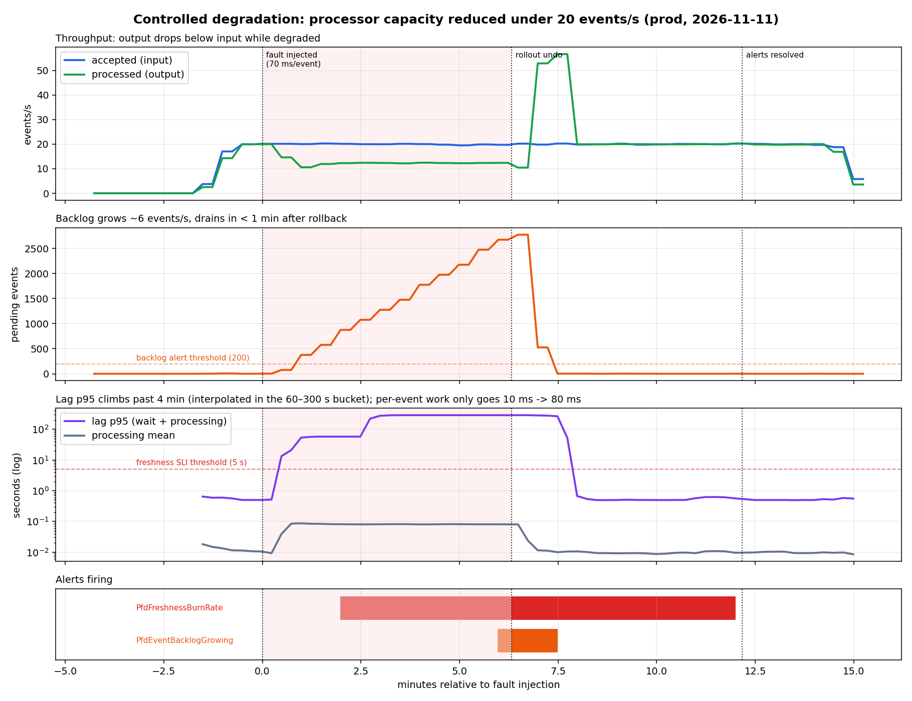

# Incident analysis: controlled processor capacity reduction (MET-07, P3-5, spec 5.11)

| | |
|---|---|
| Environment | `pfd-prod`, image `5067931` (release run 42937322510) |
| Date | 2026-11-11, 02:00–02:18 UTC |
| Type | Controlled, reversible degradation (fault injection), followed by mitigation by rollback |
| Reproduce | `scripts/degradation-experiment.sh prod 70`, then `python3 scripts/export-evidence.py prod <dir>`, then `uv run scripts/plot-experiment.py <dir>` |
| Evidence | [`docs/evidence/2026-11-11-prod/degradation/`](evidence/2026-11-11-prod/degradation/): `timeline.log`, `marks.env`, `series.csv`, `comparison.md`, `logs-sample.txt`, `trace.txt`, `screenshots/` |



## 1. Summary

Under the reference load (20 events/s), we added a 70 ms delay per event in the processor. Processing
capacity fell to 12.4 events/s, below the input rate. The backlog grew at ~7 events/s to about 2,700 pending events,
and receive→processed lag rose from 0.5 s to over 4 minutes. Ingestion was **not** affected: the API kept
accepting at 20 events/s with p95 under 45 ms, and no request failed. `PfdFreshnessBurnRate` fired 2 minutes after
injection and `PfdEventBacklogGrowing` 6 minutes after. Rolling the processor back to its previous revision
drained the backlog in 51 s (~55 events/s catch-up). Both alerts resolved, and no accepted event was lost.

## 2. Hypothesis (written before the run, in the script header)

> A per-event delay of 70 ms caps the single processor at ~14 events/s. Under 20 events/s input, the backlog should
> grow by ~6 events/s and lag should exceed 5 s within ~1 minute. `PfdFreshnessBurnRate` should fire, followed by
> `PfdEventBacklogGrowing` (~5 min). Rolling back the processor should drain the backlog and resolve both.

Result: **confirmed**, with one correction. Normal per-event work is ~10 ms, not negligible, so the real cap
was 1 / (70 + 10 ms) ≈ 12.4 events/s and the backlog grew at ~7.4 events/s rather than 6.

## 3. Procedure

1. **Baseline (3 min):** 20 events/s from the generator (`sustained`, seed 5001) against `https://api.<ip>.sslip.io`.
2. **Inject:** `kubectl -n pfd-prod set env deployment/processor PROCESSOR_ARTIFICIAL_DELAY_MS=70`. This creates
   revision 6, annotated `experiment: inject 70ms delay`. The load continues.
3. **Wait for detection:** poll the Prometheus alerts API until both alerts are firing.
4. **Mitigate:** `kubectl -n pfd-prod rollout undo deployment/processor`, back to the revision without the override.
5. **Verify recovery:** wait for backlog < 50 and both alerts resolved, observe 2 more minutes, stop the load.

Preconditions checked: no `Pfd*` alert firing and 5-minute late ratio = 0 before starting. A first attempt was
**aborted before injection** because `PfdFreshnessBurnRate` was still firing from the P3 tests. A cause can't
be attributed against a dirty baseline (kept in `degradation-aborted-dirty-baseline/`).

## 4. Timeline (UTC; t relative to fault injection)

| t | UTC | Event | Source |
|---|---|---|---|
| −3m16s | 02:00:33 | Load starts, 20 events/s | marks.env |
| −8s | 02:03:41 | Baseline end: processed 20.0/s, pending 1, lag p95 0.50 s | comparison.md |
| **0** | **02:03:49** | **Fault injected**: processor revision 6 (70 ms/event) Ready | timeline.log |
| +29s | 02:04:18 | Processed rate falls (14.6/s, then ~12/s), pending starts rising; lag p95 already 13 s (> 5 s), so events count as late | series.csv |
| **+1m59s** | 02:05:48 | **`PfdFreshnessBurnRate` firing** (5m late ratio ≈ 100%, 1h > 14.4%, held 1m) | series.csv `alert_freshness` |
| +2m45s | 02:06:34 | Lag p95 > 4 min, pending ≈ 1,000 | series.csv |
| **+5m59s** | 02:09:48 | **`PfdEventBacklogGrowing` firing** (pending > 200 and rising for 5m) | series.csv `alert_backlog` |
| **+6m19s** | **02:10:08** | **Mitigation**: `rollout undo`, processor without override Ready. Peak pending ≈ 2,780 | timeline.log |
| +7m10s | 02:10:59 | Backlog < 50 (drained in 51 s at ~55 events/s) | timeline.log |
| +7m14s | 02:11:03 | `PfdEventBacklogGrowing` resolved (backlog no longer > 200) | series.csv |
| +8m50s | 02:12:39 | Lag p95 back under 1 s | timeline.log |
| **+11m44s** | 02:15:33 | **`PfdFreshnessBurnRate` resolved** (5m window clean of late events) | series.csv |
| +14m16s | 02:18:05 | Load stopped; final pending 0, processed = accepted | timeline.log |

## 5. Symptom, detection and signals

**Symptom (client-facing):** events take minutes instead of under a second to become processed, so alerts derived
from them (ESC3-07) and aggregates arrive late. Ingestion itself stays healthy, so clients see no errors.
That is why availability-style monitoring alone would have missed this incident.

**Detection:** `PfdFreshnessBurnRate` (SLO burn) fired first, at +1m59s. It is the user-impact signal.
`PfdEventBacklogGrowing` (symptom) followed at +5m59s and points to the mechanism: processing is below
ingestion. Time to detect ≈ 2 min, of which 1 min is the alert's `for: 1m`.

**Before / during / after** (from `comparison.md`, 1-minute rates at the end of each phase):

| Signal | Baseline | Degraded (before mitigation) | Recovered |
|---|---|---|---|
| Accepted (input), events/s | 19.9 | 19.8 | 19.7 |
| Processed (output), events/s | 20.0 | **12.4** | 20.1 |
| Pending backlog, events | 1 | **2,677** | 2 |
| Lag p95 (wait + processing), s | 0.50 | **288** | 0.50 |
| Processing time per event, mean, ms | 10 | **80** | 9 |
| Late ratio (lag > 5 s), 5m | 0% | **100%** | 0% |
| Ingestion API p95, ms | 41 | 24 | 28 |
| Processor CPU, cores | 0.076 | 0.060 | 0.086 |

Reproduce the key comparison in Prometheus (Grafana → Explore), evaluated at each phase timestamp:

```promql
sum(pfd:events_processed:rate1m{namespace="pfd-prod",result="processed"})       # output rate
pfd:events_backlog:max{namespace="pfd-prod",status="pending"}                    # backlog
sum(rate(event_processing_duration_seconds_sum{namespace="pfd-prod"}[1m]))
  / sum(rate(event_processing_duration_seconds_count{namespace="pfd-prod"}[1m])) # per-event work
```

**Logs** (`logs-sample.txt`): each processed event logs `eventId`, `deviceId`, `durationMs`, `outcome` and `trace_id`.
During the degraded phase (+2 to +5 min) the median `durationMs` across 200 lines is **78.2 ms** (min 75, max 125). Before and after it is ~7–10 ms.

```logql
{k8s_namespace_name="pfd-prod", service_name="processor"} | json | durationMs > 50
```

**Traces** (`trace.txt`): trace `303624e1…` is a `process_batch` of **7.96 s** from the degraded phase. Its
`process_event` children take ~80 ms each, so a batch of 100 events takes ~8 s instead of ~1 s. Each
`process_event` span links back to the ingestion request that accepted the event, so the wait between ingest and
processing is visible as the gap between the two traces.

## 6. Causal mechanism

1. The processor handles claimed events sequentially. Its throughput is 1 / (per-event time) ≈ 1 / 10 ms ≈ 100
   events/s in theory, ~55 events/s observed while catching up (DB round trips and batch overhead).
2. The injected delay raised per-event time to ~80 ms, so capacity fell to **12.4 events/s**, below the 20 events/s input.
3. The surplus (~7.4 events/s) accumulates as `pending` rows. Queueing theory says that once utilisation is above 1 the
   queue grows without bound, and wait time grows linearly with it. Observed: ~2,700 pending after 6 min ≈ 7.4/s × 365 s.
4. Lag = queue wait + processing, so it is dominated by the wait (minutes), while processing itself only went from 10 to 80 ms.
   **Per-event latency barely moved; waiting caused the incident.** That is the distinction P3-5 asks to quantify.
5. Ingestion is decoupled through the durable queue (the `events` table), so the API stayed fast and nothing was
   rejected or lost. Durability held: final stats show processed = accepted, 0 failed.

## 7. Operational response

- **Mitigation chosen:** `kubectl rollout undo deployment/processor`, back to the last known-good revision. Rollback is the fastest
  safe action when a degradation lines up with a change (the change is visible in `rollout history` and as the
  purple "Deployments" annotation on the dashboard).
- **Alternative:** `kubectl scale deployment/processor --replicas=3` would also restore throughput
  (rows are claimed with `FOR UPDATE SKIP LOCKED`, so replicas don't double-process). It would hide the cause instead of removing it.
- **Rollback does not restore data, and didn't need to:** no data was modified. The accepted events waited in the queue and were
  processed after recovery.

## 8. Recovery validation

- Backlog 2,780 → < 50 in **51 s** after the rollback, then steady at 0–12 (normal poll granularity).
- Lag p95 back to **0.50 s** (= baseline). Per-event mean back to **9 ms**.
- Both alerts returned to normal: backlog at +7m14s, freshness at +11m44s. The freshness alert waits for its
  5-minute window to contain no late events, so it clears ~5 min after the lag returns to normal, by design.
- No loss: `/v1/stats` at the end shows `pending 0, processing 0, failed 0` and `processed = accepted` (28,492).
- Configuration matches git again: the processor has no env override (`kubectl get deploy processor -o yaml`).

## 9. Limitations and confounders

- **The 1h alert window was primed by earlier tests.** The P3 tests (burst above capacity, processor stop) left the
  1-hour late ratio at 15.5% (already above the 14.4% threshold) before the experiment. So `PfdFreshnessBurnRate`
  fired as soon as the **5-minute** window crossed. On a clean hour it would have needed ~1,000 late events (~2.5 min
  at this rate) for the 1h window to cross as well, so detection would have taken ~3–4 min instead of 2.
- **Deduplicated events in the baseline:** the aborted first attempt used the same generator seed. The first ~1,720
  events of this run were retransmissions, correctly answered as `duplicate` and not reprocessed. So input
  only appears in the metrics from −1.7 min. The baseline still covers ~90 s of real steady state at 20 events/s.
  (Side benefit: it shows deduplication working across runs 8 minutes apart.)
- **Coarse duration histogram:** `event_processing_duration_seconds` buckets are 1, 10, 100 ms… Both 10 ms and 80 ms fall in
  the same (10, 100] bucket, so **p95 can't show the change (83 → 97 ms)**. The mean (sum / count) does.
  Follow-up: add 25/50/75 ms buckets.
- **Lag p95 is interpolated:** 288 s is an interpolation inside the (60 s, 300 s] bucket. The oldest event actually
  waited ~6 min (≈ peak backlog / net drain rate). Percentiles from classic histograms are estimates.
- **Single node, one run, synthetic load:** results show the mechanism, not production-grade capacity numbers.
  CPU was never the bottleneck (processor CPU *fell* during the incident because it was sleeping), so CPU-based
  autoscaling wouldn't have helped. That is an argument for scaling on backlog or lag instead.
- **Detection depends on traffic:** with no input, freshness has nothing to measure. `PfdProcessorStalled` covers a
  stopped processor at low traffic.

## 10. Follow-ups

| Action | Why |
|---|---|
| Finer buckets for `event_processing_duration_seconds` (25/50/75 ms) | Make p95 sensitive in the 10–100 ms range |
| Consider a KEDA/HPA rule on backlog (`pfd:events_backlog:max`) for the processor | CPU doesn't reflect this failure mode |
| Unique seeds per run in `degradation-experiment.sh` | Avoid deduplicated events in the baseline |
| Treat dev alerts as informational (route by `namespace`) | Low dev traffic makes ratio-based alerts noisy |
